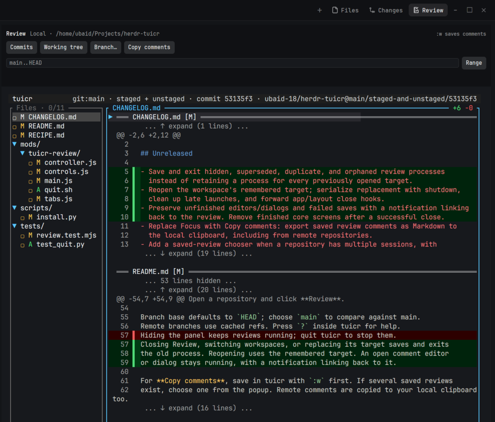

# herdr-tuicr

Review local and remote Git repositories with [tuicr](https://tuicr.dev) inside
[Herdr](https://herdr.dev), right beside Files and Changes.

<a href="preview-full.png" title="View the full screenshot">
  
</a>

*Beta — full interactive local/remote validation is still pending.*

- **Built-in syntax highlighting**, powered by tuicr, makes code and diffs easier to review.
- Review commits, working-tree changes, ranges, and branches without checkout.
- Runs on the repository's machine; Review appears where Git and tuicr are available.
- Separate terminals, selected targets, and range drafts per workspace.

## Install

Requires **Herdr app 0.1.15** with `hc`, and **Git, tuicr 0.28+, and a POSIX shell** on
each repository's machine. **[tuicr](https://tuicr.dev) must be installed separately**,
including on remote machines. Installing agents must explain and check this
dependency; see [RECIPE.md](RECIPE.md#before-installing-for-agents).

Tell your agent:

> Read ~/.config/herdr-app/AGENTS.md, then add this mod: https://github.com/ubaid-18/herdr-tuicr

Your agent will ask whether to **add Review to an existing layout** or **create a
new layout**, then ask which layout to use. Custom tab bars are merged; built-in
layouts require a personal copy.

For a **new layout via script**, with **Python 3.10+**, open Herdr and run:

```sh
git clone https://github.com/ubaid-18/herdr-tuicr.git
cd herdr-tuicr
python3 scripts/install.py          # dry run
python3 scripts/install.py --apply  # install
```

The script creates and switches to `main-tuicr`. It refuses existing names and
custom tab bars. Use `--layout NAME`, `--as NAME`, or `--home PATH` to customize.

## Use

Open a repository and click **Review**.

| Control | Action |
|---|---|
| Commits | Open tuicr's commit selector |
| Working tree | Review uncommitted changes |
| Range | Review a range such as `HEAD~1..HEAD` |
| Branch… | Choose a branch and comparison base |
| Copy comments | Copy saved review comments to your local clipboard |

Branch base defaults to `HEAD`; choose `main` to compare against main.
Remote branches use cached refs. Press `?` inside tuicr for help.
Closing Review, switching workspaces, or replacing its target saves and exits
the old process. Reopening uses the remembered target. An open comment editor
or dialog stays running, with a notification linking back to it.

For **Copy comments**, save in tuicr with `:w` first. If several saved reviews
exist, choose one from the popup. Remote comments are copied to your local clipboard too.

## Develop

With Node 22+ and Python 3.10+:

```sh
npm test
npm run check  # native Herdr checks for all five UI roles
```

To uninstall, ask your agent to remove Review and restore the previous tab bar.
For a dedicated clone, switch away before deleting it. Remove mod folders only
when no layout uses them; see [removal details](RECIPE.md#removing-review).

[Details & limitations](RECIPE.md) · [Changelog](CHANGELOG.md) ·
[Apache-2.0](LICENSE) · [Attribution](NOTICE)
