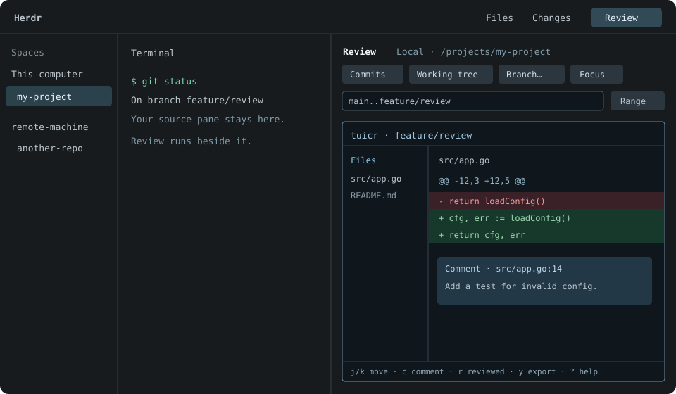

# tuicr Review

A native Review button alongside Files and Changes opens the actual tuicr TUI
inside the right-hand panel. It follows the source workspace's repository and
machine, remembers separate range drafts per workspace, and disappears where
tuicr is unavailable.

## What you see

- The standard Herdr tab bar with Files, Changes, and a 14px Review icon/button.
- A resizable right panel, initially widened to at least 640 logical pixels on
  first Review open. There is no explicit maximum panel width.
- A 126px header: Review title and machine/repo, Commits / Working tree / Branch…
  / Focus controls, a range field, Range button, and optional error text.
- Below it, a real native terminal, not a rendered copy of tuicr's output.
- A 520×450 branch popup with editable base (HEAD), search, up to eight visible
  rows, local/remote labels, and keyboard instructions. The selected row stays
  visible by sliding the rendered slice.
- Theme colors throughout, 11px header text, 26px header buttons, rounded corners.
  tuicr draws and themes its own terminal contents.

## How it behaves

- Discovery uses the focused model pane's live cwd and active space's machine.
  While the embedded terminal is focused, keep the source pane's last cwd.
- Probe `command -v tuicr` through `sh -lc`, `git rev-parse --show-toplevel`, and
  local/cached-remote refs through `git for-each-ref`; never fetch or check out.
- Hide Review unless an absolute tuicr executable and Git repo are found.
  Refresh discovery/ref metadata every 60 seconds and on source-folder changes.
  Detach the previous source's terminal immediately while a new source loads or
  has no repository. Keep a known source usable during periodic refresh.
- Commits opens tuicr's selector, Working tree adds `-w`, Range adds `-r` with one
  argument. Branch selection generates `base..refs/heads/name` (or a remote ref).
- Retain terminals and selected targets by workspace/machine/repo/mode/range.
  Restore each workspace/repo's range text, including drafts not submitted yet.
- Ignore stale branch popups and queued requests when their workspace no longer
  matches. Validate that a range/base is not an option/control-character input.
- Closing the panel or switching sources never kills a review. Reuse a live
  terminal; recreate the terminal block when Herdr removes it after process exit.
- Open/select/widen/attach Review in one layout update, so a stale snapshot cannot
  undo the click. Launches are locked per workspace/repository, not globally.
  Pending discovery preserves a workspace's Review-panel selection.
- Focus only after a bounded, delayed check confirms the correct visible block
  and live terminal. Stop waiting after source changes, superseded clicks, or a
  hidden panel. Avoid "no such pane" by not focusing ahead of layout application.
- Handle review requests after rendering, not inside it. Clear prior errors before
  reusing a good terminal, not only before starting a new one.
- tuicr owns review progress/comments/exports and any forge actions. Agent states
  working/blocked/done/idle retain the shipped tab-bar appearances; this mod does
  not infer an agent status from tuicr or animate a new spinner.

## Built from

One `mods/tuicr-review` folder, with no shipped layout or keymap:

- `main.js` default-exports a View and dispatches by props.
- `props.role: "tabs"` uses `tabs.js` and its `Review` controller.
- Default role renders `controls.js`; `empty: true` selects the launcher body,
  `picker: true` selects the branch popup.
- Imports `gpui-kit`, `gpui-base`, and Herdr APIs, plus relative modules inside
  the same mod folder. Shipped icon paths remain Herdr-owned assets.
- Tab-bar implementation derived from Herdr app 0.1.15, Apache-2.0.
- `tuicr-review.ui` / `.request` shared channels; mod-local storage for runs,
  selected targets, and range drafts.
- `exec` for Git and PATH lookup on the source machine. `hc run --bg --json
  --no-parent --no-notify --cwd …` for reviews, optionally `--on machine`,
  with `tuicr-review.panel` and `.target` labels.
- Uses `layout.select/show/hide/resize/set` and `pane.focus {terminal}`.
  Update the personal layout's `review-terminal` block, not a model pane.

Integrate into a personal clone of a main-style layout: `tabs` uses this mod with
`role: "tabs"`; `panel-body` keeps Files and Changes plus a `review` column.
That column holds the 126px `review-controls` block and weighted
`review-terminal` block. `examples/review-node.json` contains that column.
The installer uses Herdr's clone command, then atomically edits that specific
clone's layout file. The app's file watcher preserves the separately cloned
click/look state; installation never uses an active-layout `layout.set`.

## Watch out

- Trusted code runs programs and reads repositories outside its mod folder.
  Remote operations use the existing machine connection. No automatic installs.
- Never overwrite a shipped mod/layout or edit Herdr's `.state` files.
- Existing Review integrations and custom tab bars need a manual merge; the
  supplied installer refuses collisions instead of guessing.
- `cx.notify()` is illegal during render. Delayed callbacks need their own `cx`.
- The native check cannot prove later async states or deferred popup rows work.
- Hiding tuicr does not stop it; quitting it can remove its composition block.
- Native Windows targets, multiwindow coordination, per-terminal font size, and
  full startup-error presentation are not implemented.
- tuicr session data itself is keyed by tuicr, not this mod. Workspace isolation
  here means terminals/selected targets/range drafts, not a new tuicr data store.

## Done when

- `herdr-app check` passes for controls, tab bar, picker and empty state.
- In an installed personal layout, Review appears for local and remote repos
  with tuicr, and is absent when the program is missing.
- Real tuicr opens in the side panel for selector, worktree and valid ranges.
- A chosen branch produces a range without changing the checkout.
- Two workspaces using the same repo keep distinct terminals and range drafts.
- Quit and reopen a review: its deleted terminal slot is reconstructed.
- No render-phase notification errors; reopening a good review clears stale errors.
- One click opens/reopens Review even while layout commands are queued.
- A layout switch during installation cannot redirect the structural edit.
- Saved sizes and appearance carry into the new clone.
- Existing Files/Changes, keyboard shortcuts, source terminals, and the old TUI
  remain unchanged. The installer does not publish the repository.
